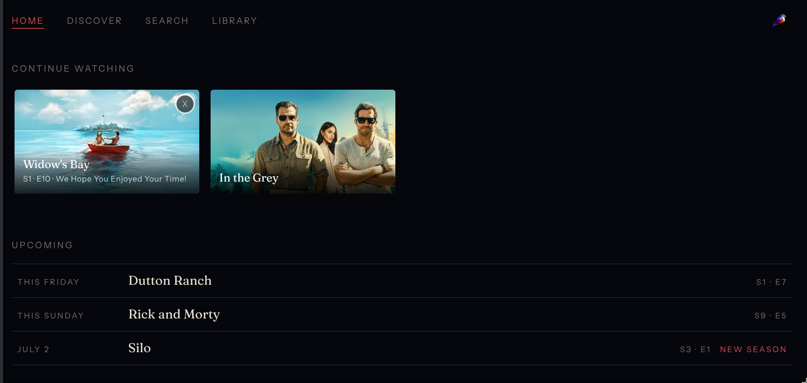

<p align="center">
  
</p>

# depot

A self-hosted home media server with a [beautiful, no-cruft UI](https://github.com/pachun/aviary).

<p align="center">
  
</p>

Depot runs on a [UGreen NAS](https://www.ugreen.com/), but any x86 NAS with three or more drive bays and two or more M.2 NVMe slots works. It uses one NVMe as the OS drive and a second (bought separately) for download staging, which keeps streaming smooth while downloads are in progress. The HDDs are arranged RAIDZ1. Any one drive can fail; swap in a new one and the pool rebuilds itself.

**The steps below describe how to turn a brand new NAS device into a family media depot**.

You'll also need some accounts:

- [Tailscale](https://tailscale.com) (free)
- [ProtonVPN](https://protonvpn.com) (paid ~$5/mo)
- [Frugal Usenet](https://www.frugalusenet.com) (paid ~$60/yr)
- [NZBGeek](https://nzbgeek.info) (paid ~$15/yr)
- [IPTorrents](https://iptorrents.com) (invite only)
- [OpenSubtitles.com](https://www.opensubtitles.com) (free, optional — improves the hit rate when filling in missing English subtitles)

[Email me](mailto:nick@pachulski.me) if you want an IPTorrents invite.

## 1. Create a bootable USB drive

- [Download the Arch ISO](https://archlinux.org/download/)
- Plug the USB drive into your machine.
- Find its name: run `lsblk` and look for something like `/dev/sda`, not a partition like `/dev/sda1`
- Flash the ISO: `sudo dd if=ARCH_ISO_FILE.iso of=/dev/DRIVE_NAME bs=4M status=progress oflag=sync`

## 2. Prevent recurring NAS shutdowns

UGreen's preconfigured watchdog reboots every 180 seconds unless it detects the vendored OS and we run Arch.

- Power on while spamming **Ctrl + F12** to enter GRUB
- Press `c` to open a console
- Run `fwsetup` to reboot into the BIOS
- Go to **Advanced** → **Watchdog** and disable it
- Save and exit

## 3. Boot from the USB drive

- Plug the USB drive into the NAS
- Power on while spamming **Ctrl + F12**
- Press `c` to open a console
- Go to **Boot** → **Boot Option 1** → Press **Enter** → Select bootable USB drive
- Save and exit

The machine will restart and boot into the live Arch ISO.

## 4. Install Arch

```
pacman -Sy --noconfirm git
git clone https://github.com/pachun/depot /tmp/depot
/tmp/depot/install/arch
```

After reboot, sign in.

## 5. Enable SSH

```
~/code/depot/install/ssh
```

Run the displayed `ssh` command from your favorite machine and continue the install from there.

## 6. Get a ProtonVPN WireGuard config

qBittorrent's seed traffic is routed through ProtonVPN so your ISP can't see it.

You need a paid ProtonVPN plan (the free tier blocks P2P). Then:

1. Sign in at https://account.protonvpn.com/downloads.
2. **WireGuard configuration**:
   - tick **NAT-PMP (Port Forwarding)** (required for inbound peers)
   - pick a P2P-capable server
   - Create → Download → you get a `.conf` file.

## 7. Enable Tailscale HTTPS certificates

1. Open https://login.tailscale.com/admin/dns.
2. Under **HTTPS Certificates**, click **Enable HTTPS…**.

## 8. Enable Funnel for tailnet members

Aviary's UI is published via Tailscale Funnel so family members not on your tailnet can reach the sign-in page. Without this ACL entry, depot's `tailscale funnel … on` call during install fails.

Paste this into the top level of the JSON at https://login.tailscale.com/admin/acls/file:

```json
"nodeAttrs": [
  {
    "target": ["autogroup:member"],
    "attr":   ["funnel"]
  }
]
```

## 9. Install orchard

[Orchard](https://github.com/pachun/orchard) contains my dotfiles for convenience when SSHing into the NAS.

They also install ruby, which `depot install` needs in a later step.

```
~/code/depot/install/orchard
```

Re-run any time to update to orchard's latest version.

## 10. Install the depot CLI

```
~/code/depot/install/depot-cli
```

## 11. Install depot

```
depot install
```

## 12. Open Aviary in your browser

`depot install` outputs Aviary's URL. Open it in your browser and sign in.

## Updating

- `depot update` — update all depot services
- `depot update <service>` — update a specific depot [service](https://github.com/pachun/depot/tree/main/services).

For Aviary development, make and test changes locally, commit and push Aviary
and any Depot configuration changes, then pull the committed changes on the NAS
and rebuild with the checked-in Compose configuration (or run
`depot update aviary`). Verify the NAS checkout matches the pushed commit and
is clean. Do not deploy copied, uncommitted source files or container-only fixes.

## Daily Wire

Aviary and Perch can browse The Ben Shapiro Show and The Sunday Special,
including member episodes, using a Daily Wire membership connected on the NAS.
The apps use their existing Aviary sign-in; they never need a Daily Wire password
or access token.

On the NAS, run `python ~/code/depot/services/aviary/daily-wire-login --user-id JELLYFIN_USER_ID`
and approve the displayed device code on Daily Wire's website. Use `--household`
instead to grant access to every signed-in Aviary user. User IDs are available
from Jellyfin's user administration. On later reconnects, omit these options to
retain the existing access list.

The login saves credentials at `~/hdds/.config/aviary/data/daily-wire/tokens.json`
in a private directory, with permissions `0600`. Aviary's container reads this
as `/data/daily-wire/tokens.json` through `DAILY_WIRE_TOKEN_FILE`. Tokens survive
container rebuilds and renew automatically before expiration. Back up this file
privately with Aviary's persistent data; it grants membership access.

If Daily Wire revokes the session, rerun the login command. No password is stored.
Daily Wire's unofficial endpoints may change; DRM-protected videos are not supported.
This integration streams episodes on demand and does not download them or sync
watch progress with Daily Wire or Jellyfin.

## Reimaging

We can create a credentials file and use it to answer fresh install prompts, removing the need to navigate third party web UIs and find or regenerate things.

`depot backup` creates and saves the credentials file on the NAS.

`depot backup name@host` auto scps the file to another machine.
